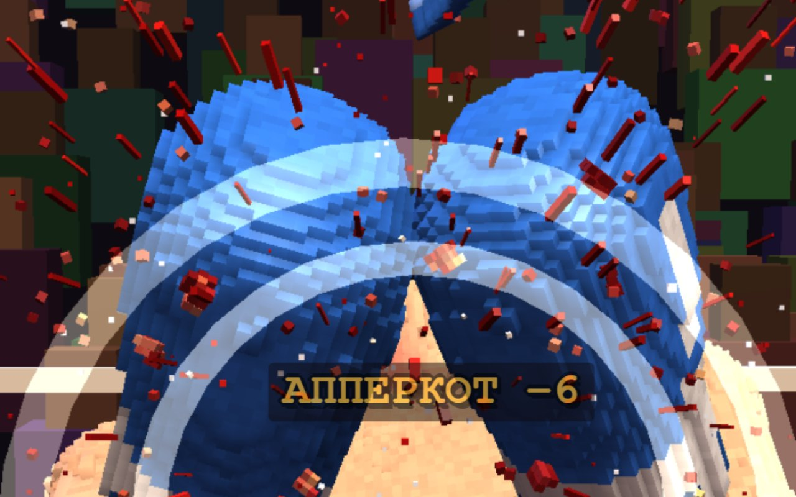

# Voxel Boxing

[Русская версия](README.ru.md)

A mobile first-person voxel boxing game with a destructible opponent. The whole game is one file, `dist/index.html`, built from `src/` with three.js r128. The in-game interface is in Russian.



**[Play in the browser](https://antropos17.github.io/voxel-boxing/)**

## Run

```bash
npm install
npx playwright install chromium   # once, tests only
npm run build
npm test
```

To play on a phone, run `npm run serve` and open `http://<computer IP>:5173` on the same Wi-Fi network.

## Layout

- `src/` – script fragments that `build.js` concatenates into one file
- `dist/index.html` – the built game
- `tests/` – Playwright tests (smoke, soak, monkey, gore, timing)
- `docs/` – architecture, performance and sound notes, current status (`docs/STATUS.md`, in Russian)
- `Unity/` – a separate Unity experiment with an anatomical voxel head, described in `docs/STATUS.md`

## Stack

JavaScript, three.js r128, Node build script, Playwright.

## Credits

Sounds are rendered with [earshot](https://github.com/Leonxlnx/earshot) (MIT). Full list of sources and licenses: [CREDITS.md](CREDITS.md) (Russian) and `assets/sounds/CREDITS.md`.
